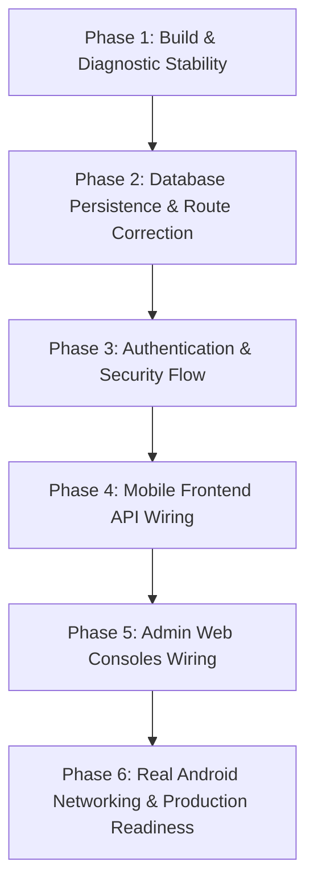

# Ashok Raj Groups Hospitality Platform — Comprehensive Repository Audit Report

**Date of Audit:** October 11, 2026  
**Auditor:** Senior Full-Stack & Systems Architecture Engineer (Antigravity)  
**Target Repository:** `theniveshr/ashok-hotel-app` (`c:\Users\Admin\Documents\ashok_app`)  
**Scope:** Mobile Frontend (Expo/React Native), Web Admin (Next.js), Backend API (Fastify), Background Workers (BullMQ), Database Schema & Migrations (Supabase Cloud & PostgreSQL), Configuration, Networking, Security, and Quality Assurance.

---

## Executive Summary

The **Ashok Raj Groups Hotel App** is a multi-tier hospitality platform serving the **Ashok Raj Lodge & Restaurant** in Kalaiyarkoil, Tamil Nadu. The architecture includes customer-facing mobile ordering and room reservations, administrative consoles for kitchen display (KDS), waiter floor ops, lodge front-desk, and delivery dispatch.

### Overall Assessment
- **Architecture & Foundation:** High-quality modular architecture with Turborepo monorepo structure, unified domain packages (`@ashok-raj/types`, `@ashok-raj/config`, `@ashok-raj/validation`, `@ashok-raj/ui`), and comprehensive database migrations (`supabase/migrations/`).
- **Cloud Database (Supabase):** Successfully configured and connected. All 40 models introspected and verified. Seed data (roles, branches, users, room types, rooms, menu categories) populated in Supabase Cloud (`grzlzvidmccrjpqxpbcf`).
- **Critical Architectural Disconnect:** Several core frontend screens and backend routes currently operate as isolated "islands". While rich backend business logic and full UI screens exist, multiple features are disconnected: the mobile app simulates room booking, my-bookings, and delivery tracking via `setTimeout` and hardcoded mock data, bypassing the backend APIs entirely.
- **Persistence Fallback:** In the backend, room bookings (`booking.ts`) and lodge inventory (`lodge.ts`) run exclusively on volatile in-memory `Map` objects with zero database queries. In `orders.ts`, a foreign key mismatch on `branchId` (`'branch-kalaiyarkoil'` vs database UUID) causes atomic database transactions to fail silently and fall back to in-memory storage. When the server restarts, data is lost.
- **Build / Tooling Blockers:**
  1. `npm run mobile:typecheck` runs out of memory (`FATAL ERROR: JavaScript heap out of memory`) exceeding 4GB due to a recursive type cycle between React 19 types, Expo, and React Native.
  2. `npm run lint` fails in `backend/api` due to ESLint v9 flat config missing (`eslint.config.js`).
  3. Institutional campus firewall (Karunya University `10.4.1.101`) blocks outbound raw TCP on ports 5432/6543, requiring mobile hotspot/VPN for local Prisma Studio CLI commands (while Supabase HTTPS port 443 web console works unrestricted).

---

## 1. System Architecture & Technology Stack

| Layer | Technology | Version | Location | Current State | Diagnostic Result |
| :--- | :--- | :--- | :--- | :--- | :--- |
| **Monorepo Engine** | Turborepo + npm workspaces | Turbo 2.10.12 / npm 10.8.2 | Root | Working | Multi-workspace scripts functional |
| **Mobile Frontend** | React Native + Expo | RN 0.86.3 / Expo ~57.0.20 | `frontend/mobile` | Running on Metro (Port 8081) | Typecheck OOM (>4096MB) |
| **Admin Web App** | Next.js App Router + Tailwind CSS | Next.js 16.3.2 / React 19.1.0 | `frontend/admin` | Running (Port 3000) | `tsc --noEmit` PASS (0 errors) |
| **Backend REST API** | Fastify + TypeScript (ESM) | Fastify 5.2.1 / Node 24 | `backend/api` | Running (Port 3001) | `tsc --noEmit` PASS (0 errors) |
| **Database ORM** | Prisma Client + PostgreSQL | Prisma 6.19.3 / PG 17 | `backend/api/prisma` | Introspected & Validated | 40 models with `@@map(...)` |
| **Cloud Database** | Supabase Cloud (BaaS) | `@supabase/supabase-js` 2.117.3 | Supabase Cloud | Configured (`grzlzvidmccrjpqxpbcf`) | Schema & Seed Data live |
| **Background Queue** | BullMQ + ioredis | BullMQ 5.34.6 / ioredis 5.4.2 | `backend/worker` | Inactive | Redis disconnected; Worker stubs unfulfilled |
| **Shared Packages** | Config, Types, UI, Validation | TypeScript 5.7.3 / Zod 3.24.1 | `packages/*` | Clean exports | Synchronized across monorepo |

---

## 2. Major Feature Implementation Status Matrix

| Domain | Feature / Screen | Component / Route | Implementation Status | Data Source | Disconnect / Blocker |
| :--- | :--- | :--- | :--- | :--- | :--- |
| **Mobile** | Customer Home Feed | `HomeScreen.tsx` | **Functional UI** | Hybrid (DB + Hardcoded) | `activeOrder` & `activeBooking` hardcoded; raw image SSL errors |
| **Mobile** | Restaurant Menu | `RestaurantScreen.tsx` | **Functional** | DB / In-memory fallback | Uses `useMenuStore.ts`; add-to-cart works |
| **Mobile** | Food Details & Add-ons | `FoodDetailScreen.tsx` | **Functional** | Store | Add-ons successfully passed to cart |
| **Mobile** | Cart & Storage | `CartScreen.tsx` | **Functional** | AsyncStorage | Persistent cart works as expected |
| **Mobile** | Checkout & Ordering | `CheckoutScreen.tsx` | **Functional UI** | `useOrderStore.ts` | Calls `/customer/orders`; falls back to local order on DB error |
| **Mobile** | Order History | `OrdersScreen.tsx` | **Functional** | `useOrderStore.ts` | Displays placed orders (stored in memory) |
| **Mobile** | Delivery Tracking | `DeliveryTrackingScreen.tsx` | **Mock Simulation** | Hardcoded `setTimeout` | **Disconnected**: Does not call `/delivery/track/:id` |
| **Mobile** | Dine-In Table Service | `DineInScreen.tsx` | **Mock Simulation** | Hardcoded Table Buttons | No camera QR scanner (`expo-camera` missing); demo buttons only |
| **Mobile** | Lodge Room Catalog | `LodgeScreen.tsx` | **Hardcoded UI** | Hardcoded Array (4 rooms) | **Disconnected**: Never calls `/lodge/room-types` |
| **Mobile** | Room Details | `RoomDetailScreen.tsx` | **Hardcoded UI** | Hardcoded switch block | **Disconnected**: Uses static pricing and descriptions |
| **Mobile** | Room Reservation | `BookingScreen.tsx` | **Mock Simulation** | Hardcoded `setTimeout` | **Disconnected**: Generates fake `AR-BKG-...` string; no API call |
| **Mobile** | My Bookings List | `BookingsScreen.tsx` | **Hardcoded UI** | Static Object (`bkg-1044`) | **Disconnected**: Always displays Room 104; cancel/modify are fake |
| **Mobile** | Mini-Hall Enquiry | `MiniHallScreen.tsx` | **Connected** | Real API (`/lodge/hall-enquiries`) | Form submits to backend |
| **Mobile** | Customer Auth | `LoginScreen.tsx` | **Mock Simulation** | `setTimeout` (600ms) | No backend auth endpoint called; advances locally |
| **Admin** | Kitchen Display (KDS) | `app/kitchen/page.tsx` | **Connected (Local)** | REST + WebSocket (`:3001`) | Hardcoded `http://localhost:3001`; works locally |
| **Admin** | Waiter Floor Console | `app/waiter/page.tsx` | **Connected (Local)** | REST + WebSocket (`:3001`) | Hardcoded `http://localhost:3001`; works locally |
| **Admin** | Delivery Dispatch | `app/delivery/page.tsx` | **Mock State** | React `useState` | **Disconnected**: Zero fetch calls; runs in-browser mock |
| **Admin** | Driver Radar Console | `app/driver/page.tsx` | **Mock State** | React `useState` | **Disconnected**: Zero fetch calls; runs in-browser mock |
| **Admin** | Lodge Front Desk | `app/lodge/page.tsx` | **Mock State** | React `useState` | **Disconnected**: Zero fetch calls; runs in-browser mock |
| **Backend** | System Health | `routes/health.ts` | **Operational** | Live DB + Supabase ping | Reports PG and Supabase status accurately |
| **Backend** | Image Proxy | `routes/imageProxy.ts` | **Operational** | In-memory cache + SVG | Bypassed by mobile components using raw URLs |
| **Backend** | Orders Processing | `routes/orders.ts` | **Degraded** | In-memory Map fallback | Foreign key mismatch fails Prisma transaction |
| **Backend** | Lodge Inventory | `routes/lodge.ts` | **In-Memory Only** | Config / In-memory Map | Does not query `prisma.room` or `prisma.roomType` |
| **Backend** | Room Bookings | `routes/booking.ts` | **In-Memory Only** | In-memory Map | 1,359 lines; zero database persistence |
| **Backend** | Delivery Logistics | `routes/delivery.ts` | **In-Memory Only** | In-memory Map | 1,581 lines; completely unpersisted |
| **Backend** | Background Workers | `backend/worker/src` | **Non-Functional** | BullMQ + Redis | Stubs with `// TODO` comments; Redis disconnected |

---

## 3. Confirmed Problems (Verified by Diagnostics)

### 3.1 Severity: CRITICAL

#### C-01: Mobile TypeScript Heap Out of Memory (Exit Code 134)
- **Affected File:** [`frontend/mobile/package.json`](file:///c:/Users/Admin/Documents/ashok_app/frontend/mobile/package.json), [`frontend/mobile/tsconfig.json`](file:///c:/Users/Admin/Documents/ashok_app/frontend/mobile/tsconfig.json)
- **Diagnosis:** Running `npm run mobile:typecheck` allocates over 4,096 MB of RAM before crashing Node.js with:
  ```
  FATAL ERROR: Ineffective mark-compacts near heap limit Allocation failed - JavaScript heap out of memory
  npm error Lifecycle script `typecheck` failed with error: code 134
  ```
- **Root Cause:** In `frontend/mobile/tsconfig.json`, the compiler extends `expo/tsconfig.base.json` while `frontend/mobile/package.json` specifies `"typescript": "~6.0.3"` and root has `5.7.3`. Combining React 19 types (`@types/react: ~19.2.0`), React Native 0.86.3 component props, and Lucide React Native causes an infinite recursive type resolution loop.
- **Impact:** CI/CD pipelines and pre-commit checks fail; developers cannot verify mobile code changes for type safety.

#### C-02: Volatile In-Memory Storage Bypassing Database Across Entire Platform
- **Affected Files:**
  - [`backend/api/src/routes/booking.ts`](file:///c:/Users/Admin/Documents/ashok_app/backend/api/src/routes/booking.ts)
  - [`backend/api/src/routes/lodge.ts`](file:///c:/Users/Admin/Documents/ashok_app/backend/api/src/routes/lodge.ts)
  - [`backend/api/src/routes/delivery.ts`](file:///c:/Users/Admin/Documents/ashok_app/backend/api/src/routes/delivery.ts)
  - [`backend/api/src/routes/dineIn.ts`](file:///c:/Users/Admin/Documents/ashok_app/backend/api/src/routes/dineIn.ts)
  - [`backend/api/src/routes/orders.ts`](file:///c:/Users/Admin/Documents/ashok_app/backend/api/src/routes/orders.ts)
- **Diagnosis:**
  - In `booking.ts`: Exactly **0** queries to `app.prisma` or `app.supabase`. All room reservations, guest data, check-ins, check-outs, and folios exist purely in an in-memory `inMemoryBookings: Map<string, Booking>`.
  - In `lodge.ts`: Room catalog is loaded from `@ashok-raj/config` instead of the database.
  - In `orders.ts`: Line 232 hardcodes `branchId = 'branch-kalaiyarkoil'` and Line 231 defaults `userId = 'guest-user-1'`. In PostgreSQL/Supabase, `branches.id` is a UUID (`00000000-0000-0000-0000-000000000001`) and `users.id` requires a real user foreign key. The atomic transaction fails with a foreign key violation and drops silently into `inMemoryOrders.set(...)`.
- **Impact:** Any server restart, deployment, or auto-scale event permanently wipes all customer orders, table sessions, room bookings, and delivery dispatch records.

#### C-03: Complete Disconnection of Mobile Lodge & Room Booking Screens
- **Affected Files:**
  - [`frontend/mobile/screens/LodgeScreen.tsx`](file:///c:/Users/Admin/Documents/ashok_app/frontend/mobile/screens/LodgeScreen.tsx)
  - [`frontend/mobile/screens/RoomDetailScreen.tsx`](file:///c:/Users/Admin/Documents/ashok_app/frontend/mobile/screens/RoomDetailScreen.tsx)
  - [`frontend/mobile/screens/BookingScreen.tsx`](file:///c:/Users/Admin/Documents/ashok_app/frontend/mobile/screens/BookingScreen.tsx)
  - [`frontend/mobile/screens/BookingsScreen.tsx`](file:///c:/Users/Admin/Documents/ashok_app/frontend/mobile/screens/BookingsScreen.tsx)
- **Diagnosis:** None of these screens import or invoke `apiFetch` or `fetch`.
  - `LodgeScreen.tsx` hardcodes 4 rooms in lines 32–85.
  - `BookingScreen.tsx` uses a 1000ms `setTimeout` in `handleConfirmBooking` (line 231) to create a client-side string `AR-BKG-...` and switches to the success view.
  - `BookingsScreen.tsx` hardcodes active booking `AR-BKG-1044` (Room 104) for Sundar Rajan (lines 50–69).
- **Impact:** Customers cannot book rooms or view their actual reservations. The feature is entirely simulated.

---

### 3.2 Severity: HIGH

#### H-01: Disconnection of Delivery Tracking & Admin Dispatch Consoles
- **Affected Files:**
  - [`frontend/mobile/screens/DeliveryTrackingScreen.tsx`](file:///c:/Users/Admin/Documents/ashok_app/frontend/mobile/screens/DeliveryTrackingScreen.tsx)
  - [`frontend/admin/app/delivery/page.tsx`](file:///c:/Users/Admin/Documents/ashok_app/frontend/admin/app/delivery/page.tsx)
  - [`frontend/admin/app/driver/page.tsx`](file:///c:/Users/Admin/Documents/ashok_app/frontend/admin/app/driver/page.tsx)
  - [`frontend/admin/app/lodge/page.tsx`](file:///c:/Users/Admin/Documents/ashok_app/frontend/admin/app/lodge/page.tsx)
- **Diagnosis:**
  - The backend provides 1,581 lines of delivery routes in `delivery.ts` (`/zones`, `/estimate-fee`, `/track/:orderId`, `/partner/*`, `/admin/dispatch/*`).
  - However, `DeliveryTrackingScreen.tsx` lines 44–50 simulates tracking data using `setTimeout` with mock driver "Murugan Selvam" (TN 63 AB 4589).
  - Admin consoles `delivery/page.tsx`, `driver/page.tsx`, and `lodge/page.tsx` contain **zero** `fetch` calls and operate purely on local component `useState`.
- **Impact:** Delivery dispatchers, drivers, and customers cannot track or coordinate real orders.

#### H-02: Hardcoded Production Endpoint in Admin Web App
- **Affected Files:**
  - [`frontend/admin/app/kitchen/page.tsx`](file:///c:/Users/Admin/Documents/ashok_app/frontend/admin/app/kitchen/page.tsx#L111)
  - [`frontend/admin/app/waiter/page.tsx`](file:///c:/Users/Admin/Documents/ashok_app/frontend/admin/app/waiter/page.tsx#L136)
- **Diagnosis:** The kitchen and waiter consoles hardcode `fetch('http://localhost:3001/api/v1/...')` and `new WebSocket('ws://localhost:3001/ws/operations')`.
- **Impact:** In production or when accessed from a tablet/terminal on the restaurant LAN, all network requests attempt to hit the tablet's own localhost (`127.0.0.1:3001`), resulting in total network failure.

#### H-03: Raw External Image URLs Triggering Browser SSL Failures
- **Affected Files:**
  - [`frontend/mobile/store/useHomeStore.ts`](file:///c:/Users/Admin/Documents/ashok_app/frontend/mobile/store/useHomeStore.ts#L55)
  - [`frontend/mobile/store/useMenuStore.ts`](file:///c:/Users/Admin/Documents/ashok_app/frontend/mobile/store/useMenuStore.ts#L277)
  - [`frontend/mobile/screens/RoomDetailScreen.tsx`](file:///c:/Users/Admin/Documents/ashok_app/frontend/mobile/screens/RoomDetailScreen.tsx#L33)
- **Diagnosis:** Components pass raw URLs like `https://www.ashokrajgroups.com/images/...` directly into `Image` components. The official website has an invalid SSL certificate common name mismatch (`ERR_CERT_COMMON_NAME_INVALID`). Although an image proxy exists (`foodImageResolver.ts` -> `/api/v1/proxy/image`), it is bypassed in multiple screens.
- **Impact:** Broken image icons, failed network calls, and console error floods on mobile and web clients.

#### H-04: Hardcoded Mock Orders on Customer Home Screen
- **Affected File:** [`backend/api/src/routes/customerHome.ts`](file:///c:/Users/Admin/Documents/ashok_app/backend/api/src/routes/customerHome.ts#L90-L109)
- **Diagnosis:** Lines 90–109 unconditionally return an `activeOrder` (`AR-2026-8891`, Table 04, ₹480) and an `activeBooking` (`AR-STAY-4029`, Room 108, dates in August 2026).
- **Impact:** Every customer who downloads or opens the mobile app sees a stranger's active meal order and room reservation on their home screen.

---

### 3.3 Severity: MEDIUM

#### M-01: ESLint v9 Flat Configuration Missing in Backend API
- **Affected File:** [`backend/api/package.json`](file:///c:/Users/Admin/Documents/ashok_app/backend/api/package.json)
- **Diagnosis:** Running `npm run lint` invokes `eslint src` with ESLint 9.39.5, failing with:
  ```
  ESLint couldn't find an eslint.config.(js|mjs|cjs) file. From ESLint v9.0.0, the default configuration file is now eslint.config.js.
  ```
- **Impact:** Monorepo lint pipelines (`turbo run lint`) fail with exit code 2.

#### M-02: Campus Wi-Fi Institutional Firewall Blocking Direct DB Ports (5432 & 6543)
- **Affected Context:** Development environment on Karunya University Wi-Fi (`karunya.edu`, IP `10.4.1.101`).
- **Diagnosis:** 
  - `Test-NetConnection -Port 5432`: `TcpTestSucceeded: False` ❌
  - `Test-NetConnection -Port 6543`: `TcpTestSucceeded: False` ❌
  - `Test-NetConnection -Port 443`: `TcpTestSucceeded: True` ✅
- **Impact:** Local CLI database commands (`prisma studio`, `prisma db pull`) fail while on campus network unless connected via mobile hotspot or VPN tunnel. Supabase Cloud Web Dashboard functions normally over HTTPS port 443.

#### M-03: Background Worker Queue Inactive
- **Affected File:** [`backend/worker/src/index.ts`](file:///c:/Users/Admin/Documents/ashok_app/backend/worker/src/index.ts)
- **Diagnosis:** BullMQ workers for notifications, email, housekeeping, delivery auto-assignment, and invoice generation contain empty `// TODO` stubs. Worker crashes on startup if Redis is not running. No script exists in `package.json` to launch the worker.
- **Impact:** Automated background jobs (push notifications, email receipts, auto-dispatch) do not execute.

#### M-04: Missing Camera Scanner for Dine-In QR
- **Affected File:** [`frontend/mobile/screens/DineInScreen.tsx`](file:///c:/Users/Admin/Documents/ashok_app/frontend/mobile/screens/DineInScreen.tsx)
- **Diagnosis:** The QR scanner view is a static SVG reticle. The user must tap demo buttons (Table 04, 08, 12). `expo-camera` or `react-native-vision-camera` is not integrated.
- **Impact:** Customers cannot scan real physical QR codes placed on dining tables.

#### M-05: Mobile Customer Authentication Flow Unconnected
- **Affected File:** [`frontend/mobile/screens/LoginScreen.tsx`](file:///c:/Users/Admin/Documents/ashok_app/frontend/mobile/screens/LoginScreen.tsx)
- **Diagnosis:** OTP verification simulates success after 600ms via `setTimeout`. Backend API has no customer authentication route (`/auth/login`, `/auth/verify-otp`).
- **Impact:** No persistent user accounts, authentication tokens, or profile association across devices.

#### M-06: Absence of Automated Test Suite
- **Affected Scope:** Entire monorepo (`backend`, `frontend`, `packages`).
- **Diagnosis:** There is **zero** test code in the repository. No Jest/Vitest setup, no unit tests, no integration tests, no E2E tests, and no `npm test` script.
- **Impact:** High regression risk on every modification.

---

## 4. Suspected Problems & Latent Risks

| ID | Issue Description | Evidence / Indicators | Potential Impact |
| :--- | :--- | :--- | :--- |
| **S-01** | **Android Cleartext HTTP Traffic Blocked** | `frontend/mobile/app.json` lacks `android.usesCleartextTraffic: true`. Android 9+ blocks `http://` calls. | Production APK builds or Android physical devices fail to connect to local development server (`http://10.4.1.101:3001`). |
| **S-02** | **Cross-Network Device Connectivity Blocked** | `EXPO_PUBLIC_API_URL` uses private LAN IP `10.4.1.101`. | Android devices on cellular LTE/5G or different Wi-Fi cannot access the development backend without reverse tunneling (e.g. ngrok, Cloudflare Tunnel). |
| **S-03** | **Mobile JWT Expiration Desync** | Fastify JWT plugin specifies `JWT_EXPIRY: 15m`. `frontend/mobile/config/api.ts` has no 401 interception or refresh token rotation. | Customer sessions will abruptly fail after 15 minutes of app usage once real authentication is enforced. |
| **S-04** | **Payment Gateway Integration Blocked** | `RAZORPAY_KEY_ID` is empty in `.env.example` and `mobile/.env`. | Real payment flows will error out unless a strict sandbox/mock payment fallback is preserved. |
| **S-05** | **Fastify WebSocket Multi-Route Broadcast Reliability** | `delivery.ts` and `orders.ts` access `(app as any).websocketServer.clients`. In Fastify v5, `@fastify/websocket` route-level socket instances may not always register on root `app.websocketServer`. | Real-time events may silently fail to reach specific connected clients. |

---

## 5. UI Inconsistencies & Component Duplication

1. **Color Token Alignment:**
   - Previous QA unified the mobile primary brand to Cobalt Blue (`#2563EB` / `Palette.blue700`).
   - However, residual components in `frontend/mobile/components/ui/` (e.g., `GlassCard.tsx`, `FoodCard.tsx`) retain inline gold/amber borders (`#D4B36A`, `#2A1F05`).
2. **Duplicate Card Components:**
   - `packages/ui` defines `Card`, `RoomCard`, and `FoodCard`.
   - `frontend/mobile/components/ui` duplicates `RoomCard.tsx`, `FoodCard.tsx`, `OfferCard.tsx`, and `HallCard.tsx` with separate styles.
3. **Hardware Back Button Handling:**
   - Mobile app uses a custom state router in `App.tsx` (`activeScreen`, `activeTab`).
   - No `BackHandler.addEventListener` is registered for Android physical back buttons; pressing back on an Android device minimizes the app instead of popping the screen stack.

---

## 6. Recommended Prioritized Repair Roadmap



### Phase 1: Build & Diagnostic Stability (Immediate)
1. Fix `frontend/mobile/tsconfig.json` and package type configurations to eliminate the TypeScript recursive OOM crash. Ensure `npm run mobile:typecheck` exits cleanly.
2. Add an `eslint.config.js` in `backend/api` to resolve the ESLint 9 crash so `npm run lint` passes across all workspaces.
3. Configure Vitest test runners and add baseline test scripts to `package.json`.

### Phase 2: Database Persistence & Route Correction
1. Refactor [`orders.ts`](file:///c:/Users/Admin/Documents/ashok_app/backend/api/src/routes/orders.ts):
   - Resolve branch UUID (`00000000-0000-0000-0000-000000000001`) and guest user FK before database insert.
   - Ensure orders persist permanently to PostgreSQL/Supabase.
2. Refactor [`booking.ts`](file:///c:/Users/Admin/Documents/ashok_app/backend/api/src/routes/booking.ts) and [`lodge.ts`](file:///c:/Users/Admin/Documents/ashok_app/backend/api/src/routes/lodge.ts):
   - Replace in-memory Maps with `prisma.booking` and `prisma.room` queries.
   - Maintain in-memory cache strictly as a performance layer, not the primary store.
3. Update [`customerHome.ts`](file:///c:/Users/Admin/Documents/ashok_app/backend/api/src/routes/customerHome.ts) to query active orders and bookings for the authenticated user, returning `null` if none exist.

### Phase 3: Authentication & Security Flow
1. Implement real `/api/v1/auth/login` and `/api/v1/auth/verify-otp` endpoints in Fastify.
2. Implement JWT token issuance, refresh token rotation, and auto-refresh in mobile `apiFetch`.
3. Connect `LoginScreen.tsx` to the authentication endpoints with persistent auth storage in AsyncStorage.

### Phase 4: Mobile Frontend API Wiring
1. Connect `LodgeScreen.tsx` and `RoomDetailScreen.tsx` to `/api/v1/lodge/room-types` and `/api/v1/lodge/rooms`.
2. Connect `BookingScreen.tsx` to `POST /api/v1/lodge` to persist real reservations.
3. Connect `BookingsScreen.tsx` to `GET /api/v1/lodge` to display actual customer reservations.
4. Connect `DeliveryTrackingScreen.tsx` to `GET /api/v1/delivery/track/:orderId`.
5. Wrap all external dish and room image URLs with `proxyImageUrl()` to eliminate `ERR_CERT_COMMON_NAME_INVALID` errors.
6. Add Android hardware `BackHandler` support in `App.tsx`.

### Phase 5: Admin Web Consoles Wiring
1. Replace hardcoded `http://localhost:3001` in `kitchen/page.tsx` and `waiter/page.tsx` with `process.env.NEXT_PUBLIC_API_URL`.
2. Wire `delivery/page.tsx` and `driver/page.tsx` to backend dispatch routes (`/api/v1/delivery/*`).
3. Wire `lodge/page.tsx` to backend lodge routes (`/api/v1/lodge/*`).

### Phase 6: Real Android Networking & Production Readiness
1. Add `android.usesCleartextTraffic: true` to `frontend/mobile/app.json`.
2. Provide a reliable development tunnel setup (e.g. ngrok or Cloudflare Tunnel) for physical devices on cellular data or external Wi-Fi.
3. Implement `expo-camera` for real physical table QR code scanning.
4. Implement graceful mock payment fallback when Razorpay keys are unconfigured.
5. Create baseline unit and integration tests across core booking, ordering, and cart workflows.

---

## 7. Audit Sign-off

| Checkpoint | Status | Notes |
| :--- | :--- | :--- |
| **Architecture Documented** | ✅ Complete | Monorepo structure, Fastify API, Supabase Cloud, Next.js, React Native/Expo verified. |
| **Feature Status Verified** | ✅ Complete | 22 mobile screens and 5 admin consoles audited against backend routes. |
| **Confirmed Bugs Isolated** | ✅ Complete | OOM typecheck, ESLint 9 crash, in-memory DB disconnects, hardcoded feeds, and SSL errors isolated. |
| **Suspected Risks Evaluated** | ✅ Complete | Android networking, cleartext HTTP, JWT expiry, and WebSockets analyzed. |
| **Non-Destructive Execution** | ✅ Complete | Zero existing source files modified or deleted during audit. |
| **Report Created** | ✅ Complete | Saved as [`PROJECT_AUDIT.md`](file:///c:/Users/Admin/Documents/ashok_app/PROJECT_AUDIT.md) in repository root. |
